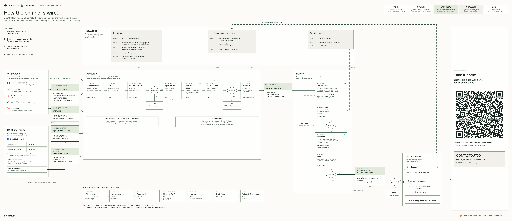

# AP automation signal engine

A worked example from the ContactOut x GTM Collective webinar (2026-11-19), built live in OXYGEN for an invented AP automation company. It sources accounts, enriches and fit-scores them, layers signals into one free score, and pays for contacts only at the top tier.

## The case

An AP automation company works about 1,800 accounts a month at a 2.1% reply rate for 9 meetings. Its problems: too many weak signals, no single account score, and enrichment costs that keep rising, because every account pays for contacts before anyone knows it matters.

The engine scores every account on cheap account-level signals first, enriches contacts only at Tier A and B, and opens each message with the trigger that put the account there. One weak signal alone never starts outreach.

The ICP, buyers and signal weights are invented for the demo and live in [knowledge/](knowledge).

## The eight stages

| # | Stage | Built with | Measured cost |
|---|---|---|---|
| 01 | Source the TAM | Accounts table from Blitz company search, deduped on the company LinkedIn URL | 4 credits for 196 accounts (1 per 50) |
| 02 | Enrich the company | `company_enrich` preset, only where the source left gaps; a free formula names the ERP from job ads | about 1 credit a company; formula free |
| 03 | Score company fit | AP Company Fit, a Classify column (A/B/C) against the ICP page | 0.075 a row |
| 04 | Layer signals, set the tier | 4 hiring tables with an AI filter, free ContactOut count of new finance leaders, free lookups and score formulas | 14.25 per hiring family; count, lookups and formulas free |
| 05 | Find the buyer | Blitz people search at Tier A/B accounts; ContactOut people search where Blitz found nobody | Blitz 1 credit per 50 people; ContactOut 16.5 per person |
| 06 | Score persona fit | AP Persona Fit, a Classify column: economic buyer, champion, user or no fit | 0.075 a row |
| 07 | Contact waterfall | Work email Blitz first, ContactOut on a miss; MillionVerifier, BounceBan on catch-all; LinkedIn only without a verified email | Blitz 1.5 and ContactOut 16.5 per hit, nothing on a miss |
| 08 | Prioritized outbound | Why-now AI line, 4 draft Sequences by trigger, approval before enrollment | why-now about 4 a row, Tier A/B only |

Column-by-column definitions, prompts and formulas: [tables.md](tables.md).

## What the build produced

**First pass, Blitz signals only:** 385 accounts → 180 Fit B (0 Fit A) → 3 Tier B → 1 buyer. A market-wide sample rarely hits the same company twice, so single signals stayed below the line.

**With the ContactOut layer:** 385 accounts → 180 Fit B → 82 with a new finance leader → **7 Tier A + 3 Tier B** → 13 buyers → 12 emails (4 found by ContactOut) → 1 approval to enroll 13. About 480 credits in total. Nothing was sent.

- **How Tier A happens:** fresh AP or CFO hiring, a finance leader new in the seat, and the stacking bonus. An aerospace parts maker with 4 AP postings scored 25 + 20 + 10 = 55.
- **Tier B:** fresh ERP-migration postings at a furniture manufacturer naming SAP, a construction firm naming Microsoft Dynamics and a logistics software firm naming NetSuite.
- **The weak-signal rule worked:** single AP, CFO or audit postings scored 15 to 25 and stayed Tier C.
- **The size gate stopped spend:** a defense contractor, a big-box retailer and an EV maker all name SAP in their job ads and stayed Fit C on size.
- **Why-now spend:** about 4 credits a row at Tier A/B only. The same column on all 385 accounts would cost about 1,540.
- **Buyers:** CFOs (economic buyers), controllers (champions) and AP managers (users). MillionVerifier checked every email; BounceBan ran on the one catch-all.

## ContactOut in the engine

The webinar was co-marketed with ContactOut, which slots into four places:

1. **Size the pool for free.** `contactout.people_count` takes up to 50 domains and a list of titles per call and costs nothing. At the 179 Fit B accounts it counted 820 finance buyers, about 98% of them with an estimated work email.
2. **A new-CFO signal nobody else covers.** The same free count with `years_in_current_role: ["0_1"]`, run once per account, finds finance leaders in their first year. W1b found one at 82 of 180 fit accounts and writes the count to Accounts as a 20-point signal. It is the layer that turned single hiring signals into Tier A.
3. **The waterfall.** Work email runs Blitz first and ContactOut on a miss, billed only on a hit. In the build ContactOut found 4 of the 12 emails, all ones Blitz missed. The free `work_email_status` and `phone_status` checks say whether ContactOut holds the data before you pay; phone runs for Tier A only.
4. **Past champions.** `contactout.email_profile_enrich` turns a former customer contact's old work email into their current profile, so a job change shows up (16.5 credits a check).

## Workflows

Recipe source in [workflows/](workflows). Each runs on demand here; the production schedule is in a comment at the top of each file. OXYGEN Workflows replace the glue scripts (for example in n8n) that usually connect these steps.

| Workflow | What it does | Ceiling per run |
|---|---|---|
| W1 Signals into Accounts | Stores the signal formulas, adds kept hiring companies that are new to Accounts, enriches them, waits, runs AP Company Fit | 400 |
| W1b New finance leaders | Free ContactOut count of leaders under 1 year in role per Fit A/B account | 20 (the counts are free; each workflow step is metered at about 0.05) |
| W2 Tier A/B to buyers | Stores the Accounts values, finds buyers (Blitz, then ContactOut), writes why-now, runs persona fit, the email waterfall, MillionVerifier and BounceBan on catch-all | 300 |
| W3 Route to outbound | Picks the Sequence from the top trigger, **pauses for a human approval**, then enrolls into a draft Sequence | 5 |

Next: W4 reads each account's SPF record weekly through a DNS-over-HTTPS GET (the native `oxygen.http_json_request` step, or a custom HTTP integration) and records newly added finance vendors as signals. W5 checks past champions monthly.

## Lessons from the build

1. **Stored values.** Formulas and lookups show live in the grid, but cross-table lookups, AI inputs and run conditions read the stored cell. Every lookup returned 0, the why-now AI saw blanks, and the persona run condition was skipped. The fix is a free `oxygen columns run <table> <column> --all --force --background` before anything reads those values; each workflow starts with it.
2. **Join on the company LinkedIn URL.** Hiring postings carry no domain. Each posting does carry the company LinkedIn URL and an AI summary of the description, which is what makes free ERP detection work.
3. **Blitz people coverage is thin at 150 to 600 employees.** ContactOut's count found 820 buyers where people search found a handful, so W2 falls back to ContactOut.

## Product gaps we hit

1. A watch-list hiring search (`signals search run --scope watch_list --domains ...`) routes to a provider that selects accounts by LinkedIn URL, drops the domains and leaves the request with no account selector. Do not run it; pass LinkedIn URLs or call the tool per account from a recipe.
2. The `company_enrich` preset keeps its own run condition and ignores a `--run-condition` passed at creation. Limit its spend by running it on exact row ids.
3. A `verify_email` column takes one verifier. Add BounceBan as a separate tool column behind a catch-all run condition.

## Run it in your workspace

Use the [signal-account-engine](../../.agents/skills/signal-account-engine/SKILL.md) skill with this folder open, or follow these steps. Preview and approve every paid step with its own ceiling.

1. Create a tables folder and a knowledge folder; save the three [knowledge](knowledge) pages with your own ICP.
2. Preview your accounts free (`oxygen companies search preview --filters-json ...`), then run the search live into an Accounts table.
3. Create the four hiring tables with `oxygen signals search run --family hiring` (keywords and AI filters in [tables.md](tables.md)), then add the free formulas.
4. Add the Accounts and Buyers columns from [tables.md](tables.md).
5. Lint and apply the recipes: `oxygen workflows lint --file workflows/w1-signals-into-accounts.ts --json`, then `oxygen workflows apply --file ... --approved --max-credits <n> --json`. Call each with `{"audit": true}` first.
6. Create the Sequences as drafts: `oxygen sequences create --name "ERP trigger" --slug ap-webinar-erp --steps-file sequences/erp.json --table buyers --url-column linkedin_url --max-credits 0 --json`. Attach senders and start only with a send ceiling you approve.

## Files

- [knowledge/](knowledge): the invented ICP, buyers, and signal weights and tiers.
- [tables.md](tables.md): every table and column, with prompts, formulas and run conditions.
- [workflows/](workflows): W1, W1b, W2 and W3 recipe source.
- [sequences/](sequences): four draft Sequences (ERP, CFO, audit and AP, past champion).
- [diagrams/](diagrams): the engine map.

**Webinar code CONTACTOUT50:** $50 off your first OXYGEN credit top-up (minimum $51, until 2026-12-31, first 100 redemptions).
